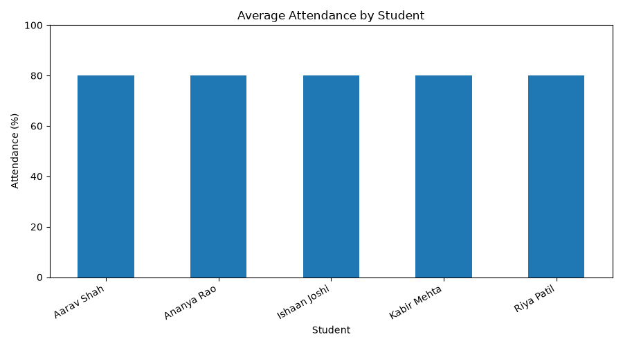
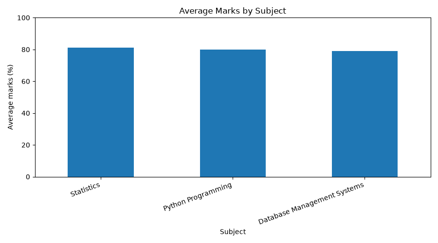

# Student Attendance & Academic Analytics System

A beginner portfolio project that uses Python and MySQL to analyse fictional student attendance and academic performance data.

## Project Overview

This project connects Python to a MySQL database, analyses student attendance and exam results, exports reports to CSV, and creates visual charts.

## Features

- MySQL database with four related tables
- Attendance percentage calculation by student and subject
- Identification of attendance below 75%
- Student marks percentage calculation
- Subject-wise average, highest and lowest marks
- CSV report generation
- Attendance and marks visualizations

## Technology Stack

- Python
- MySQL 8.0
- MySQL Connector/Python
- Pandas
- Matplotlib

## Sample Visualizations

### Attendance Analysis

### Academic Performance

## Example Reports

- [Attendance Report](attendance_report.csv)
- [Low Attendance Report](low_attendance.csv)
- [Subject Summary](subject_summary.csv)
- [Student Performance](student_performance.csv)
- [Detailed Marks Report](marks_report.csv)

## Database Structure

- `students` — student identifiers and class names
- `subjects` — subject details
- `attendance` — dated attendance records
- `marks` — marks obtained and maximum marks

The database setup scripts are provided in `schema.sql` and `sample_data.sql`.

## Setup

1. Install Python and MySQL 8.0.
2. Run `schema.sql` in MySQL Command Line Client.
3. Run `sample_data.sql` to insert fictional sample records.
4. Install the Python dependencies:

   `python -m pip install -r requirements.txt`

5. Set the Windows user environment variable `STUDENT_DB_PASSWORD` to your MySQL password.
6. Run `main.py` from Python IDLE.

Run the SQL setup against a fresh test database first if you already have data you want to preserve.

## Data Privacy

All sample names and marks are fictional. Do not publish real student records, database passwords, or other sensitive information.

## Learning Outcomes

- SQL table design and relationships
- Database connectivity with Python
- Data analysis using Pandas
- Data visualization using Matplotlib
- Automated CSV reporting

## Future Improvements

- Interactive dashboard
- Filters by date, class and subject
- More detailed attendance trends
- Improved input validation and error handling
